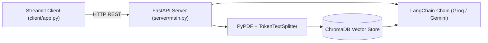

# RAG PDFBot — Modular FastAPI & Streamlit Retrieval-Augmented Generation Service

[](https://github.com/VaibhavBajpaij/RAGbot_using-fastAPI)
[](https://github.com/VaibhavBajpaij/RAGbot_using-fastAPI)
[](https://github.com/VaibhavBajpaij/RAGbot_using-fastAPI)
[](LICENSE)

**RAG PDFBot (V3)** is a decoupled **Retrieval-Augmented Generation (RAG)** question-answering application splitting a **FastAPI** backend (`server/`) and a **Streamlit** frontend (`client/`), enabling scalable PDF ingestion, vector indexing in **ChromaDB**, and multi-provider LLM chat (**Groq** & **Google Gemini**).

---

## Architecture



---

## Features

- **Decoupled Client-Server Design:** Independent `client/` UI and `server/` REST microservice (`/health`, `/llm`, upload, search, and `/chat` endpoints).
- **Multi-PDF Vector Indexing:** Parses PDFs with `PyPDF`, applies `TokenTextSplitter`, and persists vector embeddings in `ChromaDB`.
- **Dynamic LLM Provider Selection:** Fetches available Groq and Gemini models from backend config and exposes a chunk-similarity inspector in the UI.
- **Exportable Chat History:** Interactive session state with downloadable Q&A transcripts.

---

## Quick Start

### 1. Start the FastAPI Backend (`server/`)
```bash
git clone https://github.com/VaibhavBajpaij/RAGbot_using-fastAPI.git
cd RAGbot_using-fastAPI/server
python -m venv .venv
source .venv/bin/activate  # Windows: .venv\Scripts\activate
pip install -r requirements.txt
uvicorn main:app --host 127.0.0.1 --port 8000 --reload
```

### 2. Start the Streamlit Frontend (`client/`)
```bash
cd ../client
pip install -r requirements.txt
streamlit run app.py
```

Configure `GROQ_API_KEY` and/or `GOOGLE_API_KEY` in `server/.env` before running queries.

---

## Repository Structure

```text
RAGbot_using-fastAPI/
├── client/          # Streamlit UI components, API client, and session state
└── server/          # FastAPI routes, schemas, LangChain factory, and ChromaDB manager
```

Built by [Vaibhav Bajpai](https://github.com/VaibhavBajpaij).
